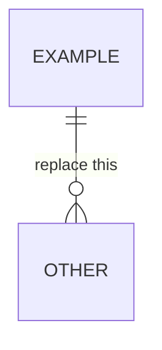

# Capstone plan

> **How to use this file.** In CP1 task 4, copy it into your task folder as `capstone/PLAN.md`. Task 4 fills every part except `## Data model` (task 5) and `## API endpoints` (task 6). Copy `capstone/` forward into every capstone task folder.
> Keep every `##` heading exactly as it is, in this order: AxReview finds each part by its heading, and grades your build tasks against this plan.
> Lines that start with `>` are guidance. Delete them when you finish a part.
> Never put real personal data in the plan: no real names, phone numbers, Aadhaar or PAN numbers, addresses or medical details.

## Product

> The name, the brief you chose (ClinicSlots, EventDesk or LendShelf) or "Own pitch", the product in two sentences, and 2 or 3 kinds of user with what each needs. When your mentor approves it on day 1, add the approval line.

**Name:**

**Brief:**

**In two sentences:**

**Users:**

- 
- 

Approved by <mentor's name> on <date>

## Hard rule

> The one rule the product must never break, in one sentence, such as "A doctor's slot never holds two active appointments". Then one example with real values, and how MongoDB will enforce it, as in RailSeat: a unique or partial unique index, or a conditional update whose filter checks the rule (such as `updateOne({ _id, seatsLeft: { $gte: 2 } }, { $inc: { seatsLeft: -2 } })`); and a transaction where several documents change. A check in the browser, or a `findOne` before a save, does not count.

**The rule:**

**An example with real values:**

**How MongoDB enforces it:**

## User stories

> 6 to 10 stories, numbered S01 onwards, each as "As a <user>, I want <goal>, so that <reason>".
> Under each story, write 2 or 3 acceptance criteria as Given, When, Then, with real values such as ₹500 or 09:30. One criterion of every story is an unhappy path: an error, an empty list or a forbidden action. At least one story's unhappy path is a user trying to break the hard rule. A finished story looks like this:
>
> **S01.** As a patient, I want to book a free slot with a doctor, so that I do not queue at the clinic.
> - Given Dr Rao's 09:30 slot is free, when I book it, then I see "Booked: Dr Rao, 09:30".
> - Given another patient booked 09:30 a moment ago, when I book it, then I see "This slot is no longer free" and nothing is booked for me.

**S01.** As a
- Given
- Given

**S02.** As a
- Given
- Given

## Must-haves and nice-to-haves

> At most 6 Must stories: the core you build in week 8. Then the Nice stories, built only if the Must stories are done and tested. Then at least three things the product will not do.

**Must (at most 6):**

- 

**Nice:**

- 

**Not in this capstone:**

- 
- 
- 

## Screens

> 3 to 5 screens of the React app, each with its route and the story IDs it serves. Mark the main screen: the one the product exists for.

| Route | Screen | Stories | Main screen? |
|---|---|---|---|
|  |  |  |  |

## Data model

> Task 5. One Mermaid `erDiagram`: one entity for each collection your Must stories store, with `PK` (the `_id`), `FK` (a field that holds another document's `_id`) and `UK` (a unique index) marks and typed fields, such as `ObjectId _id PK`, `int pricePaise`, `date startsAt`. Keep money as integer paise and times as `Date`. Label every relationship. Replace the example lines.
> Below the diagram, write one line for each link: embed or reference, and why. Then list each rule the database enforces, with its index or update filter. The hard rule is one of them.

Embed or reference:

- 

Indexes and rules the database enforces:

- 

## API endpoints

> Task 6. One line per endpoint your Must stories need: the method, the path, the story IDs, the success status and the error statuses (400, 401, 404, 409, 422). Add `GET /health`.

| Method | Path | Stories | Success | Errors |
|---|---|---|---|---|
| GET | `/health` | — | 200 | — |
|  |  |  |  |  |

## Build plan

> For each of CP1 tasks 5 to 9, the story IDs it delivers and your estimate in hours. The total is about 13 hours. If it is over, cut a Must story to Nice and say which.

| Task | Delivers (story IDs) | Estimate (h) |
|---|---|---|
| 5 Model the data with Mongoose and load seed data |  |  |
| 6 Build the core API endpoints from your plan |  |  |
| 7 Test the core endpoints, including the one hard rule |  |  |
| 8 Build the main screen and connect it to the API |  |  |
| 9 Build the second feature from your plan |  |  |
| **Total** |  | about 13 |
