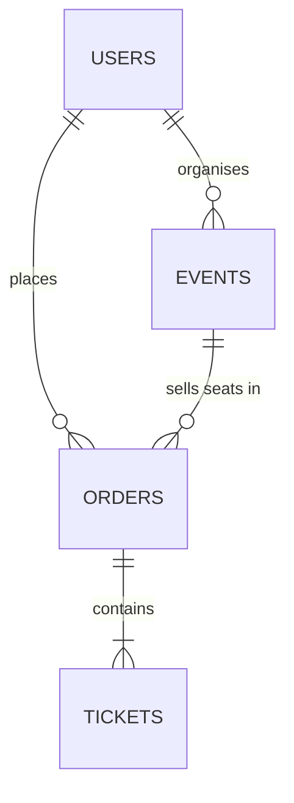

# EventDesk: a ticket desk for small events

One of the three capstone briefs. Read the [capstone README](../README.md) first: it explains the plan, `PROGRESS.md` and the AI rules.

**Stack:** Node.js and TypeScript, Express 5 with Zod, MongoDB with Mongoose, React with TypeScript. The same as RailSeat.
**The one hard rule:** never sell more tickets than an event has seats.

## The problem

A college cultural club in Kochi runs a few events a month: a stand-up night for 120 people, a workshop for 30, a film screening for 60. Tickets are sold from a shared spreadsheet and a WhatsApp group. When a popular event opens, ten people reply at once, the spreadsheet is edited by three volunteers, and the club sells 134 tickets for a hall of 120. Someone is turned away at the door.

EventDesk lists the club's events, lets a member buy up to four tickets for an event, and never sells a seat that does not exist. Organisers see how many seats are left and who is coming.

## Who uses it

- **Attendee:** browses events, buys tickets, sees and cancels their own tickets. Usually on a phone, often the moment an event opens.
- **Organiser:** creates events with a capacity and a price, sees the guest list, and checks people in at the door.

## User stories

Pick 6 to 10 of these for your plan, and write your own acceptance criteria. **Core** ideas make a good Must list (at most 6); **extra** ideas are Nice stories. The examples show the level of detail.

| # | Story idea | Kind |
|---|---|---|
| S01 | As an attendee, I want to sign up and log in (or pick a seeded demo attendee: sign-in is optional), so that my tickets are mine alone. | core |
| S02 | As an attendee, I want to see upcoming events with the seats left, so that I know what I can still go to. | core |
| S03 | As an attendee, I want to buy 1 to 4 tickets for an event, so that I can bring friends. | core |
| S04 | As an attendee, I want to see my tickets with a ticket code, so that I can show it at the door. | core |
| S05 | As an attendee, I want to cancel my tickets until 24 hours before the event, so that the seats go back on sale. | core |
| S06 | As an organiser, I want to create an event with a title, time, venue, capacity and price, so that people can buy tickets. | core |
| S07 | As an organiser, I want to see the guest list of an event, so that I know who is coming. | extra |
| S08 | As an organiser, I want to check a ticket code in at the door, so that a code cannot be used twice. | extra |
| S09 | As an organiser, I want to lower or raise an event's capacity, but never below the tickets already sold, so that I can change the hall. | extra |
| S10 | As an attendee, I want to search events by date or title, so that I find one quickly. | extra |

Example acceptance criteria for S03:

- Given the stand-up night has 3 seats left, when I buy 2 tickets, then I see "2 tickets booked" with two ticket codes, and the event shows 1 seat left.
- Given it has 1 seat left, when I try to buy 2 tickets, then I see "Only 1 seat left" and nothing is sold.
- Given I ask for 5 tickets, when I submit, then I see "You can buy 1 to 4 tickets" and the form keeps my choice.

Prices are for show: the event's price is stored in paise (₹250 is `25000`) and printed on the ticket. Nobody pays online in this capstone.

## Must-haves and nice-to-haves

**Core (week 8, tasks 5 to 9):** sign-up and log-in with two roles (attendee, organiser); creating events; the event list with seats left; buying 1 to 4 tickets with the hard rule; my tickets; cancelling; the hard-rule test.

**Extra (only if the core is done and tested):** the guest list; check-in at the door; changing capacity; search; a waiting list when an event is full.

**Not in this capstone:** online payment, QR-code scanning with the camera, email or SMS, seat maps with numbered seats.

## Suggested collections

Your data model adds the fields and indexes. Keep money in integer paise and times as `Date`.



| Collection | What it holds | Key fields |
|---|---|---|
| `users` | Sign-in, as in RailSeat | `_id`, `email` (unique index), `passwordHash`, `role` (`attendee`, `organiser`) |
| `events` | One event | `_id`, `organiserId`, `title`, `venue`, `startsAt`, `capacity`, `seatsLeft` (`min: 0`), `pricePaise` |
| `orders` | One purchase of 1 to 4 tickets | `_id`, `eventId`, `userId`, `quantity` (`min: 1`, `max: 4`), `status` (`active`, `cancelled`), `createdAt` |
| `tickets` | One seat in an order | `_id`, `orderId`, `eventId`, `code` (unique index, such as `EVD-7K2Q9X`), `checkedInAt` |

`seatsLeft` is a counter on the event, so one document holds the number every purchase must check. It starts equal to `capacity`.

**Embed or reference?** An order's tickets could be embedded in the order (they are always read with it), but the organiser's guest list and the check-in look tickets up by `code` across all orders, so a separate `tickets` collection with a unique index on `code` is simpler. Orders reference their event and user by `_id`.

## The one hard rule

**The tickets sold for an event never pass its capacity**, even when many people buy at the same moment. A cancellation gives the seats back.

**A worked example.** The stand-up night has `capacity` 120 and `seatsLeft` 2. Priya buys 2 tickets: `seatsLeft` becomes 0 and she gets two ticket codes. At the same moment Rahul asks for 1: he gets 409 "Sold out", and `seatsLeft` stays 0. Priya cancels one ticket: `seatsLeft` goes back to 1, and Rahul can buy it.

**A hint about the counter** (one transaction per purchase):

- A unique index cannot count seats, so take the seats with one **conditional update** of the event. It lowers the counter only while enough seats are left:

  ```ts
  const taken = await Event.updateOne(
    { _id: eventId, seatsLeft: { $gte: quantity } },
    { $inc: { seatsLeft: -quantity } },
    { session },
  );
  // taken.modifiedCount is 1 when the seats were yours, 0 when too few were left
  ```

  MongoDB runs the check and the change as one step on that document, so two purchases can never both take the last seat.
- The purchase changes several documents (the event, a new order, its tickets), so do all of it in **one transaction** (`mongoose.connection.transaction(async (session) => { ... })`), passing the `session` to every write. Too few seats: throw inside the transaction, so nothing is saved, and answer **409**.
- **A safety net:** `min: 0` on `seatsLeft` in the schema stops your own code from saving a negative count with `save()`. (Schema validators do not run on `updateOne` unless you ask, so the filter `$gte` is the real guard.)
- Counting the tickets with `countDocuments` and then inserting is **not** safe: two requests can both count 119.

How to prove it with a test (`capstone/api/tests/hard-rule.test.ts`, CP1 task 7), as in P2 task 20:

1. Seed one event with `capacity` 5 (so `seatsLeft` 5) and 20 attendees.
2. Send 20 `POST /events/:id/orders` with `quantity: 1` at the same moment, with `Promise.all` and supertest, each as a different attendee.
3. Assert exactly five `201` and fifteen `409`.
4. Assert the database holds exactly 5 tickets for the event, and `seatsLeft` is 0.
5. A second test: with 2 seats left, a request for 3 gets `409` and sells nothing; cancel one order, and the seat can be bought again.

## Two-week scope

| When | Task | What you build |
|---|---|---|
| Week 8, day 1 | Choose and plan | `PLAN.md`: stories, rule, collections, screens, endpoints; mentor approval |
| Week 8 | Model the data | The Mongoose models for the four collections, the unique ticket `code` index, a seed script with 6 events and 20 users |
| Week 8 | Core API | Sign-up and log-in, `GET /events`, `POST /events` (organiser), `POST /events/:id/orders`, `GET /orders/mine`, `POST /orders/:id/cancel` |
| Week 8 | Tests | The hard-rule test above, plus the 1-to-4 limit, the 24-hour cancel rule and "an attendee sees only their own orders" |
| Week 8 | Main screen | The event list with seats left, an event page with a quantity picker, the "only N seats left" message, and my tickets |
| Week 8 | Second feature | The organiser's create-event form and guest list |
| Week 9 | Ship it | Compose, one Playwright test of buying a ticket, polish, the deploy in [`deploy/README.md`](../../deploy/README.md), the README and the talk |

## What "done" looks like at the demo

In three minutes, with two browsers open:

1. An event shows "2 seats left". Two attendees each try to buy 2 tickets. One gets the tickets; the other sees "Only 0 seats left" or "Sold out".
2. Run the hard-rule test: five `201`, fifteen `409`, and `seatsLeft` at 0.
3. Log in as the organiser and show the guest list.
4. Show the live HTTPS address, then the teardown evidence.

## Data and privacy

Use made-up attendees only: no real names, phone numbers or college ID numbers. Make test users and events with your seed script, and keep every secret out of Git.
