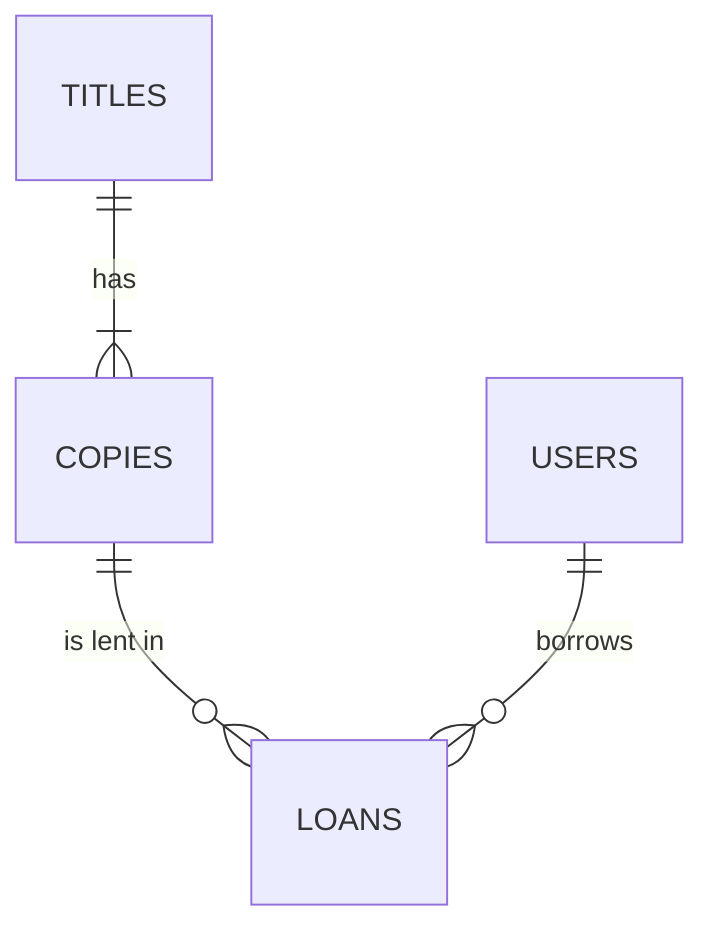

# LendShelf: loans from a community library

One of the three capstone briefs. Read the [capstone README](../README.md) first: it explains the plan, `PROGRESS.md` and the AI rules.

**Stack:** Node.js and TypeScript, Express 5 with Zod, MongoDB with Mongoose, React with TypeScript. The same as RailSeat.
**The one hard rule:** one copy, one borrower at a time.

## The problem

A residents' association in Jaipur runs a small library in its community hall: about 600 donated books, many with two or three copies, and a volunteer who keeps loans in a notebook. Members ask in the WhatsApp group whether a book is in, and the answer is often wrong. Twice last month the same copy was promised to two members.

LendShelf shows which titles have a copy on the shelf, lets a member borrow a copy for 14 days, and makes sure a copy is never out with two people. The volunteer sees what is out and what is overdue.

## Who uses it

- **Member:** searches the catalogue, borrows and returns books, and sees their own loans.
- **Librarian** (the volunteer): adds titles and copies, records returns, and sees every loan and every overdue book.

## User stories

Pick 6 to 10 of these for your plan, and write your own acceptance criteria. **Core** ideas make a good Must list (at most 6); **extra** ideas are Nice stories. The examples show the level of detail.

| # | Story idea | Kind |
|---|---|---|
| S01 | As a member, I want to sign up and log in (or pick a seeded demo member: sign-in is optional), so that my loans are mine alone. | core |
| S02 | As a member, I want to search titles by name or author and see how many copies are on the shelf, so that I know what I can borrow. | core |
| S03 | As a member, I want to borrow a copy of a title that is on the shelf, so that I can take it home for 14 days. | core |
| S04 | As a member, I want to see my loans with their due dates, so that I return them on time. | core |
| S05 | As a librarian, I want to record a return, so that the copy is on the shelf again. | core |
| S06 | As a librarian, I want to add a title and its copies, so that donated books can be borrowed. | core |
| S07 | As a librarian, I want to see every overdue loan, oldest first, so that I can remind members. | extra |
| S08 | As a member, I want to have at most 3 books out at once, so that everyone gets a turn. | extra |
| S09 | As a member, I want to renew a loan once for 7 more days, so that I can finish a long book. | extra |
| S10 | As a member, I want to join a waiting list for a title with no copy on the shelf, so that I am next when one comes back. | extra |

Example acceptance criteria for S03:

- Given "Wings of Fire" has 2 copies and 1 is on the shelf, when I borrow it, then I see "Borrowed: Wings of Fire, due 16 December" and the title shows 0 on the shelf.
- Given the last copy was borrowed a moment ago by someone else, when I borrow it, then I see "No copy is on the shelf right now" and nothing is lent to me.
- Given I am not logged in, when I try to borrow, then I am sent to the log-in page.

## Must-haves and nice-to-haves

**Core (week 8, tasks 5 to 9):** sign-up and log-in with two roles (member, librarian); titles and copies from seed data; search with copies on the shelf; borrowing with the hard rule; my loans with due dates; returns; the hard-rule test.

**Extra (only if the core is done and tested):** overdue list; the 3-book limit; one renewal; a waiting list; the librarian's add-title form.

**Not in this capstone:** fines or payments, barcode scanning with the camera, email or SMS reminders, book covers from outside websites.

## Suggested collections

Your data model adds the fields and indexes. Keep times and due dates as `Date`.



| Collection | What it holds | Key fields |
|---|---|---|
| `users` | Sign-in, as in RailSeat | `_id`, `email` (unique index), `passwordHash`, `role` (`member`, `librarian`) |
| `titles` | One book | `_id`, `title`, `author`, `year` |
| `copies` | One physical copy of a title | `_id`, `titleId`, `shelfCode` (unique index, such as `LS-0412`) |
| `loans` | One copy lent to one member | `_id`, `copyId`, `userId`, `status` (`active`, `returned`), `borrowedAt`, `dueOn`, `returnedAt` |

A copy is **on the shelf** when it has no loan with status `active`. A seed script adds about 40 titles with 1 to 3 copies each, and 20 members.

**Embed or reference?** Copies could be embedded in their title (a title has only 1 to 3), but every loan points at one copy and the index below needs `copyId` in the `loans` collection, so copies are their own collection that references the title. Loans reference their copy and member by `_id`.

## The one hard rule

**A copy is never out with two members at once.** A return makes it free again.

**A worked example.** "Wings of Fire" has two copies, `LS-0412` and `LS-0413`. Nisha borrows it and gets `LS-0412`; Arjun gets `LS-0413`. Now the title shows 0 on the shelf, and Farhan's borrow gets 409 "No copy is on the shelf right now". When the librarian records Nisha's return, `LS-0412` is on the shelf again and Farhan can borrow it.

**A hint about indexes** (the same idea as RailSeat's seats):

- A **partial unique index** on `loans`, covering only the active ones: at most one active loan per copy.

  ```ts
  loanSchema.index({ copyId: 1 }, { unique: true, partialFilterExpression: { status: 'active' } });
  ```

  A return sets `status: 'returned'` and `returnedAt`, so the loan leaves the index and the copy is free. Your seed script and test set-up call `await Loan.createIndexes()` so the index surely exists.
- Borrowing a **title** means picking a free copy. Find one free copy and insert the loan. If the index refuses the insert (error code **11000**, `E11000 duplicate key error`), another member took that copy at the same moment: answer **409**, or try the title's next free copy once.
- A `find` that picks a free copy is **not** safe on its own: two requests can both pick the same copy. The index is what makes it safe.

How to prove it with a test (`capstone/api/tests/hard-rule.test.ts`, CP1 task 7), as in P2 task 20:

1. Seed one title with exactly one copy, and 20 members.
2. Send 20 `POST /loans` for that title (or that copy) at the same moment, with `Promise.all` and supertest, each as a different member.
3. Assert exactly one `201` and nineteen `409`.
4. Assert the database holds exactly one active loan for that copy: `countDocuments({ copyId, status: 'active' })` is 1.
5. A second test: return the loan, borrow the copy again as another member, and expect `201`. With two copies and 20 requests, expect exactly two `201`.

## Two-week scope

| When | Task | What you build |
|---|---|---|
| Week 8, day 1 | Choose and plan | `PLAN.md`: stories, rule, collections, screens, endpoints; mentor approval |
| Week 8 | Model the data | The Mongoose models for the four collections, the partial unique index, the seed script |
| Week 8 | Core API | Sign-up and log-in, `GET /titles?q=`, `POST /loans`, `GET /loans/mine`, `POST /loans/:id/return` (librarian) |
| Week 8 | Tests | The hard-rule test above, plus "a member sees only their own loans" and "only a librarian records a return" |
| Week 8 | Main screen | Search with copies on the shelf, a borrow button, the "no copy on the shelf" message, and my loans |
| Week 8 | Second feature | The librarian's loans list with overdue loans first, and recording a return |
| Week 9 | Ship it | Compose, one Playwright test of borrowing, polish, the deploy in [`deploy/README.md`](../../deploy/README.md), the README and the talk |

## What "done" looks like at the demo

In three minutes, with two browsers open:

1. A title shows "1 on the shelf". Two members press Borrow. One gets the book; the other sees "No copy is on the shelf right now".
2. Run the hard-rule test: one `201`, nineteen `409`.
3. Log in as the librarian, record the return, and show the title back on the shelf.
4. Show the live HTTPS address, then the teardown evidence.

## Data and privacy

Use made-up members only: no real names, phone numbers or flat numbers. Real book titles and authors are fine; do not copy book covers or descriptions from other websites. Keep every secret out of Git.
