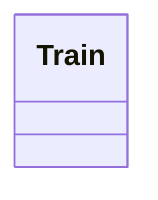

# RailSeat data model

<!-- TODO(task 11): fill every section below from the kit's data/railseat CSV files. Delete these comments when you have. -->

## Collections

<!-- One line per collection: what one document means, such as "journeys: one train running on one date". Use four: stations, trains, journeys and bookings. Users come in task 22. -->

## Example documents

<!-- One JSON document per collection, made from real CSV rows. A booking has a pnr, a status and copies of the train number, name and date. -->

## Diagram

<!-- A Mermaid classDiagram with the four collections and the embedded Stop, Coach, Seat and Passenger. Use *-- for embedded and --> for a reference, each with a label. It must render on GitHub. -->

## Embed or reference

<!-- One reason for each choice: stops, coaches, seats, passenger, the journey's train and the booking's journey. -->

## Keys and indexes

<!-- The unique keys (station code, train number, a journey's train and date, PNR) and the index search needs on the stops' station codes. -->

## Rules

<!-- "A seat has at most one confirmed booking per journey". Task 20 enforces it. -->

## Decisions

<!-- Two choices you made, each with its reason. -->
